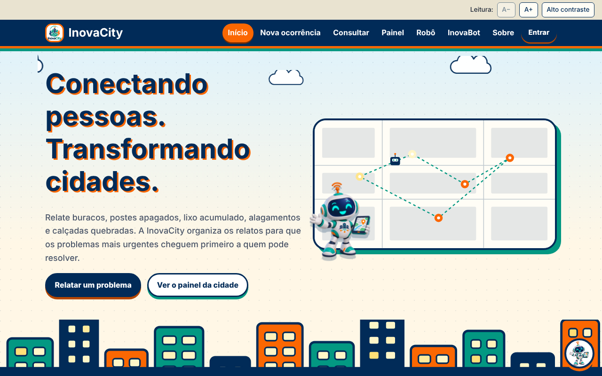
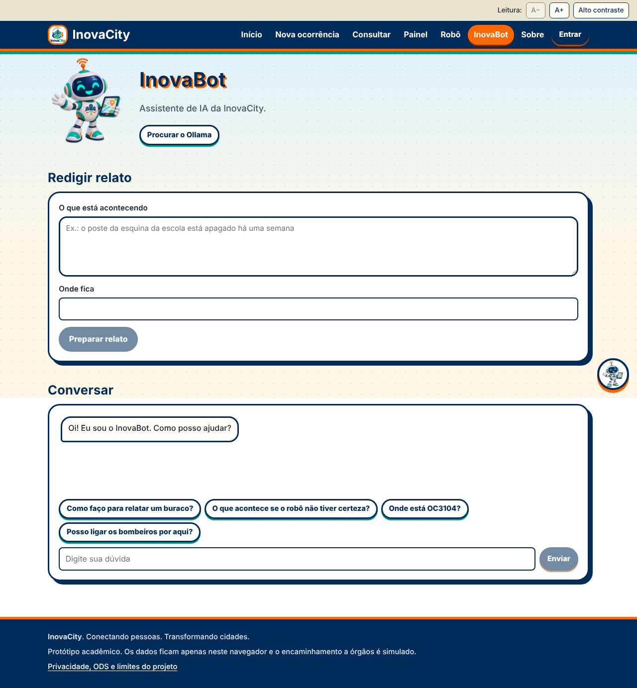
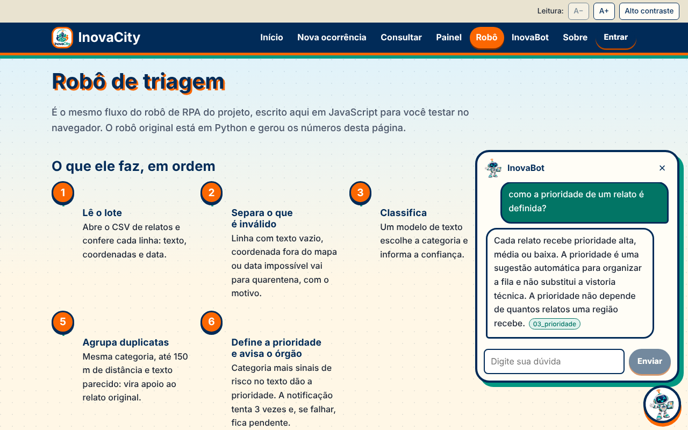
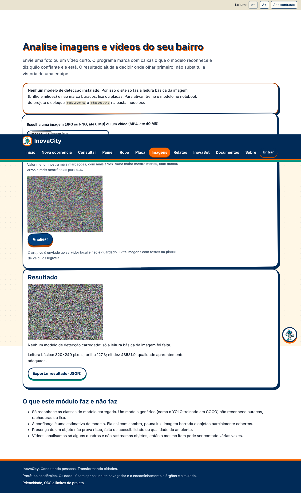

# InovaCity – Plataforma integrada (site + InovaBot + robô de RPA)

Conectando pessoas. Transformando cidades. · FIAP Global Solution 2026.2 – CitizenTech

Autores: Rodrigo Wolkoff Giorgi – RM 556980 · Carlos Eduardo Mamede – RM 568269

## Telas

| | |
|---|---|
|  |  |
|  |  |

## Rodar

```
pip install -r requirements.txt
python servidor.py
```

No Windows, dê dois cliques em `executar.bat`. O navegador abre em http://127.0.0.1:8000/.

## O que está ligado

- **Site (front-end):** `site/` (código-fonte React em `web/`).
- **InovaBot:** botão flutuante em todas as páginas e página **InovaBot** no menu. Responde dúvidas com fontes, consulta ocorrências (ex.: OC3104) e redige relatos.
- **Redigir relato com Gradio:** seção da página InovaBot (Gradio embutido). Em **Nova ocorrência**, o botão "Redigir com o InovaBot" preenche título e descrição.
- **Robô de RPA:** página **Robô**. O botão "Rodar o robô agora" executa o robô Python (`rpa/`) e o painel das execuções reais aparece na mesma página (`rpa/site/`).

## Modelo de linguagem (Qwen no Ollama)

O servidor usa o Ollama que já está instalado, escolhe sozinho o primeiro modelo com "qwen" no nome e usa LangChain quando disponível (senão, a API HTTP do Ollama). Para escolher outro: `ollama list` e depois

```
set INOVACITY_MODELO=nome-do-modelo
python servidor.py
```

Sem Ollama ligado, o InovaBot responde em modo extrativo (trechos da base, sem modelo generativo) e a página mostra o aviso. Ligou o Ollama depois? Use "Procurar o Ollama de novo" na página InovaBot.

Variáveis opcionais (ver `.env.example`): `INOVACITY_MODELO`, `INOVACITY_LLM` (auto, ollama, extrativo), `OLLAMA_HOST`, `INOVACITY_FUNDAMENTACAO` (padrão 0.5), `INOVACITY_MQTT_HOST` e `INOVACITY_MQTT_PORTA`.

## Pastas

- `servidor.py` servidor único (site, API do InovaBot, robô, Gradio em 127.0.0.1:7860)
- `gradio_relato.py` seção Gradio "Redigir relato"
- `inovabot/` assistente: base de conhecimento, código, avaliação e testes
- `rpa/` robô de RPA e seu painel
- `web/` código-fonte do site; `site/` versão já compilada

Testes: `python inovabot/tests/test_pipeline.py` e `python rpa/tests/test_rpa.py`.

Para recompilar o site com Vite: `cd web`, `npm install`, `npm run build` e copie `dist/` para `site/`.

## Administração

Entre em Entrar com:

- login: `admin` (ou `admin@inovacity.demo`)
- senha: `inovacity20@`

Abre o painel administrativo, incluindo as abas InovaBot e Robô RPA.

## Gradio

A seção de redigir relato usa o Gradio embutido quando ele está instalado (`pip install gradio`). Sem ele, o site mostra o formulário próprio.

## Módulos novos

- **Placa (IoT):** página Placa. Servidor MQTT local na porta 1883, banco SQLite em `dados_servidor/`, simulador, alertas com validação humana, detecção da placa pela USB (Chrome ou Edge) e lista de clientes MQTT. No MQTT Explorer: protocolo mqtt://, host 127.0.0.1, porta 1883, assinar `inovacity/#`. O Wokwi roda na nuvem e não alcança o seu computador: use `broker.hivemq.com` no sketch e a "ponte" da página. Código da placa em `iot/wokwi/`.
- **Imagens e vídeos (visão):** página Imagens. Sem modelo, faz só a leitura básica. Para detectar, treine no notebook `notebooks/InovaCity_Visao_Computacional.ipynb` (Colab) e copie `modelo.onnx` e `classes.txt` para `modelos/`.
- **Relatos e Fábrica de Corpus (PLN):** página Relatos. Pela linha de comando: `python corpus_cli.py arquivo1.pdf arquivo2.docx --saida corpus/`.
- **Cluster:** `python -m modulos.benchmark_cluster`.
- **Aplicativo:** o site é uma PWA instalável pelo navegador. Não é aplicativo nativo.
- **Imagens do projeto:** `pacote_visual/` tem ícones, imagens e GIFs, com `LICENCAS_E_ORIGEM.txt`.

## Onde os dados ficam

Ocorrências e contas do protótipo ficam no navegador de quem usa (localStorage). Leituras de sensores ficam no SQLite do servidor. Não há banco compartilhado entre pessoas.

